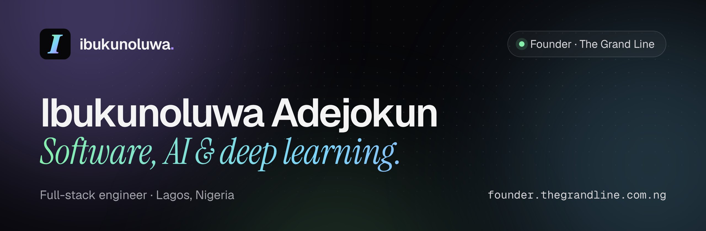

  <a href="https://founder.thegrandline.com.ng"><b>Portfolio</b></a> &nbsp;·&nbsp;
  <a href="https://thegrandline.com.ng"><b>The Grand Line</b></a> &nbsp;·&nbsp;
  <a href="https://founder.thegrandline.com.ng/pricing">Work with me</a> &nbsp;·&nbsp;
  <a href="https://www.linkedin.com/in/adejokun-ibukunoluwa/">LinkedIn</a> &nbsp;·&nbsp;
  <a href="mailto:adejokunibk@gmail.com">Email</a>

## Hi, I'm Ibukunoluwa

Full-stack engineer in Lagos, focused on software and AI: machine learning and deep learning built into products real people use. Security runs underneath everything I build.

I founded **[The Grand Line](https://thegrandline.com.ng)**, a product & creative studio. We design, build and animate digital products, websites, brands and motion, for our own products and for clients.

- **Now:** running The Grand Line and shipping its products
- **Studying:** MSc Computer Science, Redeemer's University (BSc there too)
- **Open to:** freelance builds, consulting and full-time roles

## Selected work

| Project | What it is | Status |
| --- | --- | --- |
| **[Parallel](https://parallel-ng.vercel.app/)** | FX intelligence for Nigeria: what your money is truly worth across every channel, and the best way to move it | Live |
| **[DSGN.THIZKID](https://dsgn-thizkid.vercel.app/)** | Portfolio for an Ibadan visual designer and creative director | Live |
| **Landing** | Cross-border assisted import for traders: source abroad, track every leg, land goods in Lagos | In development |
| **[The Grand Line](https://thegrandline.com.ng)** | The studio's own site: interactive hero, filterable work, live pricing estimator | Live |

From the archive: <a href="https://github.com/iadejokun/smartcart">SmartCart AI</a> (a recommendation engine that learns as you shop) and <a href="https://github.com/iadejokun/securevault">SecureVault</a> (an API key manager for legacy systems). Full write-ups on the <a href="https://founder.thegrandline.com.ng/archive">archive page</a>.

## Toolkit

**Frontend**&nbsp;

**Backend**&nbsp;

**AI / ML**&nbsp;

**Ship it**&nbsp;

## Work with me

Building something where software and AI meet? Packages, prices (in naira) and a free discovery call are on **[founder.thegrandline.com.ng/pricing](https://founder.thegrandline.com.ng/pricing)**, or email **[adejokunibk@gmail.com](mailto:adejokunibk@gmail.com)**.
